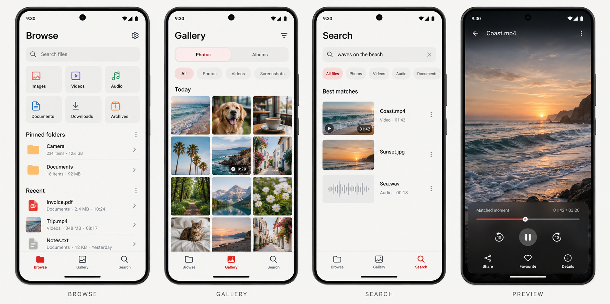

# Keeps: product UI and UX specification

**Version:** 0.1 design proposal · **Date:** 7 October 2026

**Companion:** [Play Store roadmap](PLAY_STORE_ROADMAP.md)

The interface should feel like an everyday Android file manager with an excellent gallery. Its character comes from careful spacing, simple geometry, readable typography, and small translucent controls. The user’s content supplies the color.

## 1. Visual direction and references

**Preferred visual reference:** Nothing Gallery. **Preferred browsing reference:** Files by Google. **Preferred organization reference:** Apple Files. Use these as inspiration for an original Keeps interface.

Nothing OS 5's official design references show revised typography/materials and Gallery sorting, filtering, and album organization. The current public rollout is a beta/general-release schedule, so do not treat promotional imagery as a universal installed-phone state. [Nothing OS 5](https://us.nothing.tech/nothing-os), [official Gallery changes and image](https://nothing.community/d/61730-nothing-os-50-new-features-explained)

The underlying organization references are [Files by Google](https://play.google.com/store/apps/details?id=com.google.android.apps.nbu.files&hl=en), [Apple Files](https://support.apple.com/guide/iphone/modify-files-and-folders-iphc61044c11/ios), and [Samsung My Files](https://www.samsung.com/us/support/answer/ANS10002531/).

**This is a generated concept, not implemented UI.** The written specification controls behavior and accessibility. Its illustrated category colors are optional; ship monochrome icons by default. The image's navigation is mainly solid; the specified Gallery capsule can receive the restrained translucent treatment once tested. Store screenshots must come from the finished app.

The [generation record](docs/design/IMAGE_PROMPT.md) contains the exact prompt and built-in generation mode.

## 2. Design principles

1. **Content comes first.** No launch hero, feature pitch, decorative statistics, or repeated “on your phone” badges.
2. **Actions are predictable.** Similar objects have similar menus in every destination.
3. **Visible state matters.** Location, selection, progress, and consequences must be clear.
4. **AI stays understandable.** One search entry; meaningful page/time links; setup and exceptions explained where relevant.
5. **The app works before setup completes.** Filenames, folders, and previews remain useful without AI.
6. **Accessibility is part of the style.** Regular readable text, labels with icons, adaptable layouts, solid alternatives to glass.
7. **Polish includes resilience.** Interrupted operations and denied permissions receive designed recovery states.

## 3. Design tokens

These are starting values; verify them on-device rather than treating a mockup as a contrast test.

| Token | Light | Dark |
|---|---|---|
| Canvas | Warm near-white `#F6F6F4` | Near-black `#111112` |
| Primary surface | `#FFFFFF` | `#1C1C1E` |
| Primary text | `#171719` | `#F5F5F4` |
| Secondary text | `#626267` | `#B7B7BD` |
| Divider / outline | `#D8D8DC` | `#414147` |
| Restrained selection accent | `#B8322C` | `#FF9188` |
| Decorative brand red | `#D83A33` | `#D83A33` |

Do not use decorative red for small text without verifying contrast. Give destructive actions explicit words and an appropriate semantic color; selected tabs and deletion must never be distinguished by color alone. Photos retain their original colors.

**Typography:** explore licensed Geist Sans for headings and ordinary Latin UI text, with system/Noto fallback for Hindi and unsupported glyphs. The upstream Geist font is SIL OFL-1.1; include its license if bundled. System typography is an acceptable baseline while evaluating readability and package size. [Geist repository/license](https://github.com/vercel/geist-font)

| Role | Initial scale |
|---|---|
| Screen title | 26–28 sp, medium/semibold |
| Section heading | 18 sp, medium |
| Filename / primary row label | 16 sp |
| Supporting text | 14 sp |
| Metadata / navigation label | 12–13 sp where contrast and font scaling remain adequate |
| Numerical technical data | Limited monospace, usually only Details/Settings |

Do not use dot-matrix/pixel type for filenames or controls. Use sentence case, real extensions, and two-line filenames where useful. Preserve enough of the filename ending to identify extensions when truncating.

**Geometry and spacing:** 4/8 dp spacing increments; 16–20 dp page margins; 12–16 dp row/control corners; 24–28 dp sheet corners; pills only for compact filters/navigation. Use one consistent icon family, approximately 24 dp icons inside at least 48 dp interactive targets. Avoid decorative boxes around every file.

## 4. Glass, motion, and platform behavior

Use subtle glass in **at most a couple of visible areas**, such as:

- Gallery's compact bottom navigation over media.
- The floating media-viewer controls.
- A small menu over a viewer if contrast remains dependable.

Use solid surfaces for file rows, search results, Settings, permission explanations, dialogs, and operation progress. These surfaces contain reading and consequential actions.

A translucent layer needs a tint, enough opacity, and a border/scrim to stay readable over white, black, and colorful thumbnails. Provide a **Solid controls** appearance option and use the solid treatment when effects regress on a phone.

Build the solid component first. Prototype any real backdrop blur separately; Compose's ordinary element blur does not by itself establish the required background sampling. Choose an implementation only after testing clipping, scroll/keyboard behavior, battery, frame timing, and native/platform compatibility. Do not continuously blur the entire photo grid.

Use restrained state transitions, roughly 150–250 ms as a starting point, without delaying file actions. Honor reduced-motion settings. Support Android Back/predictive Back, edge-to-edge insets, the IME, and system share sheets. Bottom controls stay clear of the gesture area; on large screens, adapt navigation and content widths.

## 5. Navigation and screen contracts

Use **Browse · Gallery · Search** in the primary bottom navigation, with visible labels. Give each destination its own remembered back stack and scroll state. Settings is a gear in the top bar, not a fourth primary tab.

Default first entry is Browse. Subsequent launches return to the last Browse/Gallery context; returning from a preview restores the exact folder, filters, and scroll position.

### Browse

Top: compact title and Settings, then a search entry. Main content:

1. Small category grid: Images, Videos, Audio, Documents, Downloads, Archives.
2. Pinned folders, initially populated only when accessible or explicitly pinned.
3. A short Recent list based on actual available/opened files, not manufactured dates.
4. Locations and compact links to Favorites and Trash.

Show device/SD/USB locations only when meaningful. Storage usage can appear as a quiet, accurate row or in Details; do not build an urgent cleanup dashboard. Explain unavailable categories instead of presenting broken-looking shortcuts.

**Folder screen:** back/up, current folder and breadcrumb trail, Search in this folder, sort/view menu, readable file rows/grid. The breadcrumb can collapse but the real current location stays visible. Distinguish metadata categories from writable destinations: “Images” is a filtered view, not a folder to move into.

Per row: thumbnail/type icon, filename, useful size/date metadata, and an accessible overflow menu. Tap opens; long-press selects. An explicit Select action provides an alternative to long-press.

### Gallery

Use top-level **Photos / Albums** segmented navigation inside Gallery.

**Photos:** date-grouped grid, remembered Captured date/Recently added sort, All/Photos/Videos/Screenshots filters with Favorites in the filter menu. Start with three columns; allow a visible density control and optional pinch. Use ordinary date headings, tiny duration badges on video tiles, and selection checkmarks with a scrim. Edited filtering can wait until an editing pipeline tracks that state reliably.

**Albums:** real folder albums with thumbnail/name/count, pinned albums first, other albums below. Reordering changes presentation; moving media between folder albums changes the file location and must use the normal move workflow. Future virtual collections will use explicit wording such as “Add to collection.”

Albums, category counts, and thumbnails must reconcile after file operations or external edits. Excluded/unavailable media is not shown as if still current.

### Search

One query field for filename, exact text, and remembered content. Small scope/type chips and a filter sheet for location/date. Search launched inside a folder starts in that folder; a visible scope control lets the user broaden it.

Before typing: local recent searches, clear-history action, and at most a short example when useful. No permanent tutorial/feature wall. Search history is local and can be disabled.

**Result layout:** mixed results with consistent media/type markers. A short exact-filename section may precede content matches. Content results include only useful provenance:

- Image: thumbnail and filename.
- PDF: filename, excerpt/thumbnail, “Page 4.”
- Video/audio: filename, representative thumbnail/waveform, “01:42.”
- Text: excerpt with a highlighted match.

Tap a result to open that page or matched interval. Provide “More moments” when one source has several useful hits. Do not display vector dimensions, similarity scores, or invented confidence percentages.

When a new query/filter produces results, reset to its top; background changes to the same query preserve reading position. Cancel obsolete requests and prevent stale results appearing for a newer query. Filenames can appear before semantic results, with calm progress feedback.

### Viewers

Images: immersive view, zoom, swipe, favorites/share/details; editing comes in a later update unless it is already reliable.

PDF: relevant page on entry, visible page controls, zoom, page number, text-match emphasis where supported. Large/damaged/encrypted inputs receive useful recovery or Open with.

Audio/video: matched interval on entry, reliable seeking, playback speed, standard transport controls, and an explicit control to return to the matched moment. Avoid surprise autoplay with sound. The preview concept's playing state is illustrative; default entry behavior is paused unless a clear play action initiated it.

Hide main-tab navigation while a viewer is open. Keep share/favorite/details reachable; show controls over a strong scrim or restrained glass. Returning restores the originating list.

### Settings

Group into:

- Appearance: System/Light/Dark, Solid controls, gallery density.
- Content search: model/setup status, included/excluded locations/types, charging policy, pause/resume, search history.
- Storage: separate original-file usage, model, index, thumbnails/cache; precise delete/clear actions.
- Privacy/help: understandable local-processing explanation, policy, notices, supported formats, support.
- Advanced: manual model import and diagnostic information where necessary.

Developer timings, embedding dimensions, raw provider identifiers, and internal status tables belong in debug-only tools.

## 6. Selection and file-operation flows

**Selection:** title changes to “3 selected”; clearly marked rows; Select all limited to the current visible scope or an explicitly described entire scope. Toolbar: Share, Copy, Move, Trash/Delete; secondary actions in a menu. Back exits selection before leaving the folder. Hidden long-press is not the sole way to perform an action.

**Copy/Move:** choose destination → breadcrumb/location navigation → “Copy here” or “Move here.” Show selected count and destination before executing. Disable invalid destinations with a reason, including moving a folder into itself.

**Conflict:** readable filename/location; Keep both, Replace where supported, Skip. “Apply to remaining conflicts” is optional and clearly scoped. Replacing data is consequential; explain consequences and recovery truthfully.

**Progress:** total files, current stage, transferred bytes when reliable, Cancel. Large operations can continue with suitable platform scheduling and visible status. Completed and failed files are separately summarized; cancellation is not reported as complete.

**Trash:** sheet states selected items and retention. Restore resolves collisions normally. Permanent deletion uses explicit wording. Undo appears only after a completed operation that can actually be reversed; it never guarantees provider recovery.

**Rename:** prefill the editable name, preserve/select extension thoughtfully, validate without dismissing the dialog, update previews/search identity when committed. **Create folder:** simple name dialog in the actual destination.

## 7. First-run and search-preparation UX

Avoid a slideshow.

1. Show a useful Browse shell with “Choose a folder” and “Show photos and videos” actions.
2. Explain access in context, then use the appropriate Android permission/picker flow. Partial/declined access has a usable path.
3. Offer Content search after locations are visible. Show model size, expected storage, Wi-Fi preference, and Enable/Later choices.
4. Let users review exclusions before background content processing.
5. Return to the library immediately. Progress belongs in Search or Settings.

If a reviewed full-file-manager access path is present, explain its shared-storage purpose at the relevant moment. Never tell a selected-folder user that the entire phone is accessible.

Example consumer copy:

| Situation | Suggested wording |
|---|---|
| No locations | “Choose a folder to start browsing.” |
| Model absent | “Enable content search” · “Download once to search locally.” |
| Setup downloading | “Downloading search model · 42%” with Pause/Cancel |
| Search preparation | “Preparing content search. Filenames are ready.” |
| Battery/charging pause | “Search preparation will continue when charging.” |
| Model unsuitable | “Content search is unavailable on this phone. File browsing still works.” |
| Access lost | “Allow access to this folder again.” |
| Unsupported semantic format | “Search by filename is available for this file.” |
| No result | “No matches here.” with Clear filters / Search all files |
| Partial long-file preparation | “Search is ready for part of this file.” with progress/details |

Avoid “Image indexed on this phone,” “768-dimensional embedding,” or “Content searchable” repeated across ordinary file cards. “Offline” or a local-processing explanation is useful in setup/privacy; it need not decorate every screen.

## 8. Accessibility and implementation

Use Jetpack Compose with a custom Material 3 theme and shared semantic components. Model-independent navigation remains usable when inference fails.

Build components for file rows, category items, album cards, thumbnail grids, filter chips, search results, operation progress, conflict sheets, source-access prompts, and the compact navigation. Compose previews should cover real state combinations, but previews are not sufficient testing.

Required acceptance:

- At least 48 dp interactive targets, visible icon labels where meaning is ambiguous.
- Text contrast target 4.5:1 for ordinary text and 3:1 for large text; test real composited glass backgrounds.
- TalkBack labels/actions for thumbnails, timestamps, selection, scope, progress, and controls; logical traversal without repeated decorative announcements.
- 200% text scaling, long/Unicode filenames, Hindi fallback glyphs, RTL, landscape, keyboard and gesture insets.
- States communicated with words/icons as well as color.
- Reduced motion and solid controls remain visually complete.
- Screen changes preserve accessibility focus; focus is not stolen by every incoming result.
- Share, permanent deletion, lost access, failed move, and partially prepared content have complete screen-reader flows.
- No thumbnail decoding, folder enumeration, PDF work, or inference on the UI thread.
- Measure the actual release build on the supported-phone matrix before enabling blur or elaborate motion.

The values above are product acceptance targets to be verified; the generated board does not certify them.

## 9. Design delivery sequence

**M1:** tokens → reusable components → Browse/folder/selection → Gallery/Albums → Search/results/viewers → setup/Settings/error states. Use real catalog data as soon as the shell exists.

**M2–M4:** replace placeholder operation states with real capabilities and recovery; align UI with source identity, model lifecycle, partial preparation, and timed/page results.

**M5:** fine spacing/motion, accessibility/localization, large libraries, low-memory handling, and measured glass effects. Every production state gets the same attention as the happy path.

The design is ready for implementation when the three main destinations, core file actions, setup choices, and failure/recovery paths are reviewable on a real phone. Attractive screenshots alone are not the design finish line.
