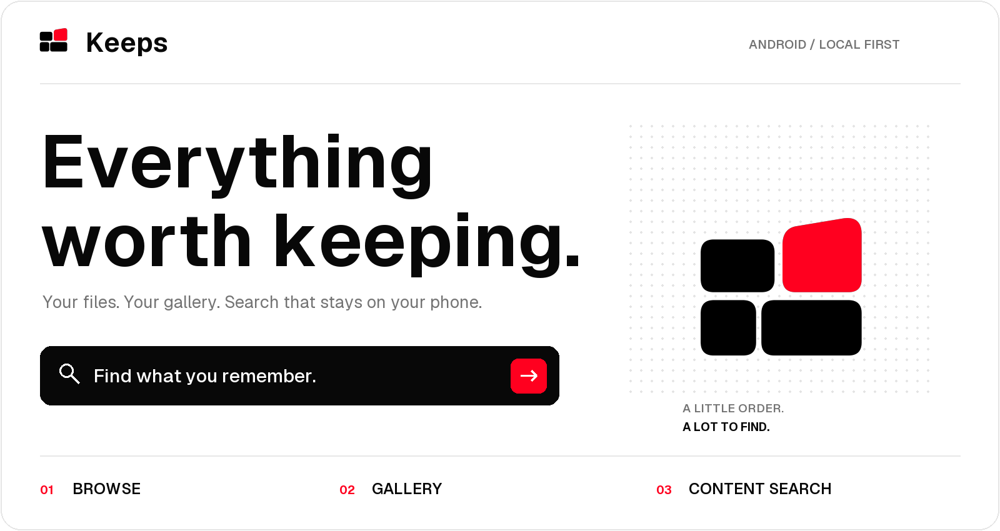
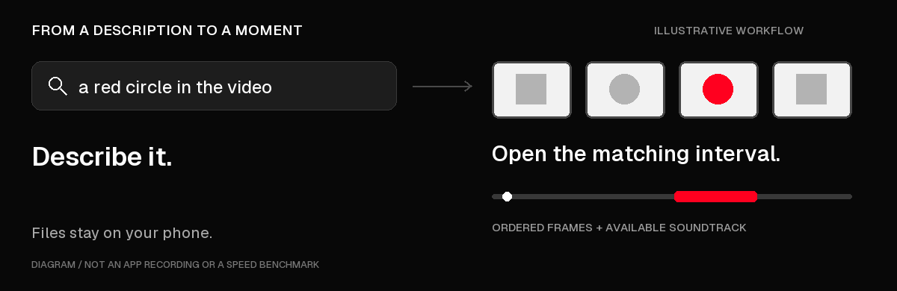

<p align="center">
  
</p>

<p align="center">
  <a href="https://developer.android.com/about/versions/12"></a>
  <a href="https://kotlinlang.org/"></a>
  <a href="https://developer.android.com/compose"></a>
  <a href="LICENSE"></a>
</p>

<p align="center">
  <strong>A file manager. A gallery. A way back to what you remember.</strong><br />
  Native Android, with optional on-device search powered by EmbeddingGemma 2.
</p>

<p align="center">
  <a href="#what-keeps-does">Explore</a> ·
  <a href="#build-it">Build</a> ·
  <a href="#make-it-yours">Get started</a> ·
  <a href="ROADMAP.md">Roadmap</a> ·
  <a href="CONTRIBUTING.md">Contribute</a>
</p>

---

You remember the scene, but not the filename. A photo from a trip. A document you saved. Something that happened halfway through a video.

Keeps brings ordinary file browsing, a visual gallery, and private content search into one app. Browse and open your files immediately. Prepare selected content when you want to search by meaning. Your originals stay in place.

> **Development preview.** Keeps is actively being built and tested. File workflows and real local inference work, but large-library reliability, search relevance, preparation lifecycle and prepared-index retention are still being verified. This is not a production release or a promise that every library finishes overnight. [Current scope and acceptance gates →](ROADMAP.md)

## What Keeps does

| Browse | Gallery | Find |
| :--- | :--- | :--- |
| Navigate accessible folders and file categories. Pin folders, revisit recent files, and search filenames without a model. | Browse real photos, videos and albums. Preview media, favorite files, and return to your place. | Describe prepared content. Open a matching photo, PDF page, sound interval, or candidate moment in a video. |

**Everyday tools, before AI setup.** New folders, rename, copy/move, collision handling, operation recovery and trash/restore are implemented where the source provides the required capability. Android may require approval for media changes; provider and interruption coverage is still in progress.

**Video search that opens a moment.** Search inside one prepared video or across prepared videos. Overlapping windows combine ordered frames with available soundtrack, with a separate visual anchor. Results offer multiple candidate intervals and timeline playback. They are approximate matches, not guaranteed event boundaries or transcripts.

**Your search library, your choice.** Select content types, review individual exclusions, and exclude whole folders—including future arrivals. Excluding from content search keeps files visible in Browse and filename search; it clears their extracted search content. Hiding files is a separate concern.

<details>
<summary><strong>See the idea in motion</strong> — illustrative diagram, not an app recording</summary>

<p align="center"></p>

Prefer no animation? [Open the still version](docs/readme/search-story.png). This diagram uses generated geometric fixtures, contains no personal media, and makes no speed claim.

</details>

## Private by architecture

- **Local inference.** The application declares no Internet permission. There is no account, remote embedding API, or synthetic embedding fallback.
- **Optional AI.** Browsing, filenames and viewers work without the model. Downloading the model is a separate browser action; import it explicitly into Keeps.
- **Originals stay original.** Preparation reads files and uses temporary, bounded inputs. Photos are resized for model input, not overwritten or permanently recompressed.
- **Local search data.** Embeddings and extracted content live in private app storage. Cloud backup and device-transfer exclusions are configured.
- **Explicit access.** Grant media access, select files/folders, or optionally allow shared-storage access. Permissions and AI preparation are separate decisions.

A cloud document provider can fetch files through its own network access. Sharing or opening a file in another app also uses that app's capabilities. “Local inference” does not turn other apps or providers into offline services.

## Make it yours

1. **Connect your library.** On first launch, choose **Open your device library** and grant the access you want. **Not now**, **Add files** and **Choose a folder** are alternatives. Android restricts selecting the internal-storage root through its folder picker; optional **All files access** is a separate setting for shared storage.
2. **Browse immediately.** Photos, albums, filenames and viewers do not require AI preparation.
3. **Add the search model.** Open **Settings → Search library → Download model**, then **Choose downloaded model**. Use the compatible **EmbeddingGemma 2 `.litertlm` pack**, not a generative Gemma model. The tested portable pack is **484,622,336 bytes**, downloaded separately. [Exact pack, revision and SHA-256](DEVICE_TESTING.md#model-provenance).
4. **Choose what to prepare.** Select Photos, Videos, Audio, PDFs or Text. Review exclusions and long videos before starting. Supported plain text can be extracted without a model.
5. **Choose when to prepare.** Use the modes below. Pause keeps completed results and the saved queue; Resume keeps the run's power policy. Ending a run keeps prepared content while clearing its pending selection.
6. **Search and open.** Describe prepared content, filter results, and open a file, page or candidate moment. Similarity scores are not probabilities.

| Preparation mode | When it runs | Files added later |
| :--- | :--- | :--- |
| **Prepare automatically** | While charging, with the screen off | Eligible new files in the approved scope are picked up |
| **Prepare while charging** | A manual run; screen may stay on | Start another run to include new files |
| **Prepare now, including on battery** | A manual run, plugged in or on battery; screen may stay on | Start another run to include new files |

Turn automatic preparation off to start a manual run. Both use the same model and mandatory thermal/resource checks. Gentle/Balanced pacing and cooling can pause work; Android can defer background execution. Session counters separate processing, short rests and other elapsed time. [Control and pacing details](docs/PREPARATION_CONTROL_AUDIT.md).

## Build it

**Requirements:** JDK **21**, Android SDK **36**, and Android **12+** (API 31+) for installation. The wrapper pins Gradle **8.14.3**. Android Studio can create the ignored, machine-specific `local.properties` file. Dependencies require network access during the initial build; the model is not needed to compile or browse files.

```bash
git clone https://github.com/EruditeCoder108/Keeps.git
cd Keeps
```

<details open>
<summary><strong>Windows · PowerShell</strong></summary>

```powershell
.\gradlew.bat :core:test :app:testDebugUnitTest :app:assembleDebug :app:lintDebug
adb install -r app/build/outputs/apk/debug/app-debug.apk
```

</details>

<details>
<summary><strong>Linux / macOS</strong></summary>

```bash
bash ./gradlew :core:test :app:testDebugUnitTest :app:assembleDebug :app:lintDebug
adb install -r app/build/outputs/apk/debug/app-debug.apk
```

</details>

Debug APK: `app/build/outputs/apk/debug/app-debug.apk`. The build packages **arm64-v8a** and **x86_64**. Inference currently uses CPU; a successful build or emulator launch does not prove model compatibility or phone performance. Debug builds are for development, not production distribution.

## Under the surface

| Layer | Implementation |
| :--- | :--- |
| Interface | Kotlin · Jetpack Compose · Material 3 |
| Catalog | Room · explicit migrations · URI/version-aware records |
| Files | MediaStore · Storage Access Framework · optional shared-storage access |
| Playback | Media3 · Android platform decoders |
| Preparation | WorkManager · retained queues · scoped exclusions · checkpoints |
| Inference | LiteRT-LM **0.18.0** · EmbeddingGemma 2 · serialized CPU calls |
| Retrieval | Normalized 768-dimensional embeddings · exact cosine search · lexical rank fusion |

```text
Files and media → local catalog → selected preparation → local embeddings
                       │                                      │
                 Browse / Gallery                    describe → rank
                       └──────── original viewer / matched moment ─┘
```

<details>
<summary><strong>Source map and data compatibility</strong></summary>

```text
app/src/main/java/dev/keeps/library/
  catalog/       Room, source identity, search and file-operation state
  sources/       MediaStore, document providers and file capabilities
  inference/     Model import, validation, local embedding engine
  indexing/      Preprocessing, queues, pacing and checkpoints
  ui/            Browse, Gallery, Search, settings and viewers
core/            Ranking, vectors, media windows and platform-free policies
app/src/test/    Simulated Android lifecycle and preparation tests
app/src/androidTest/
                 Database, migrations and opt-in device/model tests
tools/           Generated fixtures, guarded ADB helpers, publishing checks
```

The vector namespace includes the model digest, dimensions, prompt recipe, backend and preprocessing version. Incompatible model revisions require preparation again. Room schemas are exported in `app/schemas`; schema changes require real migrations. Never reset someone's data to make a test pass.

</details>

## What is still being proved

Keeps has real model, decoder, database and playback tests. Those are evidence for their recorded fixtures and environments—not a universal accuracy or performance claim.

- **Large libraries:** paging, memory at scale, sustained preparation, battery cost, reboot/OEM recovery and calibrated completion estimates remain open.
- **Search quality:** representative personal-library relevance, subtle motion, speech and codec coverage need broader evaluation. There is no speech transcript or face-recognition feature.
- **Documents:** PDFs use visual page embeddings, currently capped at the first **24 pages**. OCR, selectable PDF text and exact text/number search inside images are pending.
- **Providers and operations:** complete overlapping-source, revoked-access, changed-file and interrupted-operation coverage is still in progress.
- **Release readiness:** production signing, permission review, accessibility coverage and full dependency-notice packaging remain launch gates.

The [roadmap](ROADMAP.md) owns task status and acceptance gates. [Device testing](DEVICE_TESTING.md) and [build notes](BUILD_NOTES.md) separate observed behavior from plans. Historical reports may refer to local-only captures/logs that are intentionally not distributed.

## Build with us

Start with [CONTRIBUTING.md](CONTRIBUTING.md), pick a task from the [roadmap ledger](ROADMAP.md#11-milestones-and-task-ledger), and keep the scope concrete. Useful contributions include provider recovery, retrieval evaluation, accessibility, large-library performance and preparation reliability.

Bug reports should include the build, Android/device model, steps, expected behavior and what actually happened. **Use generated examples. Do not attach personal photos, filenames, catalog databases, embeddings, credentials or unreviewed phone logs.**

Before sharing a source snapshot, run:

```bash
python tools/audit_publication.py
```

The audit checks candidate files and reachable local Git history for selected secret/privacy patterns. It cannot prove the absence of every secret or inspect the meaning of every image. See the [publication review](docs/OPEN_SOURCE_REVIEW.md) for scope and remaining release checks.

## License and acknowledgments

**Keeps is licensed under [Apache 2.0](LICENSE).** Incorporated code and assets retain their own notices; see [NOTICE](NOTICE) and the [third-party inventory](docs/THIRD_PARTY.md).

- **Google AI Edge Gallery:** selected audio/frame-interleaving and decoding code adapted from the [pinned implementation](https://github.com/google-ai-edge/gallery/tree/3210720d3f808f51bae52798435d0c590ddc05bf), with Apache headers, modification notices and provenance retained.
- **LiteRT-LM and EmbeddingGemma 2:** the local runtime and model behind optional content search. Model packs are obtained separately; [tested provenance](DEVICE_TESTING.md#model-provenance).
- **Geist:** interface and README typography, under the [SIL Open Font License](app/src/main/assets/notices/geist-OFL.txt).

Keeps is an independent project. Upstream names and technology logos identify the tools used; they do not imply endorsement. The four-tile Keeps identity is retained in the [brand assets](docs/brand/README.md). README art and the illustrative animation can be regenerated with `python tools/create_readme_assets.py`.
